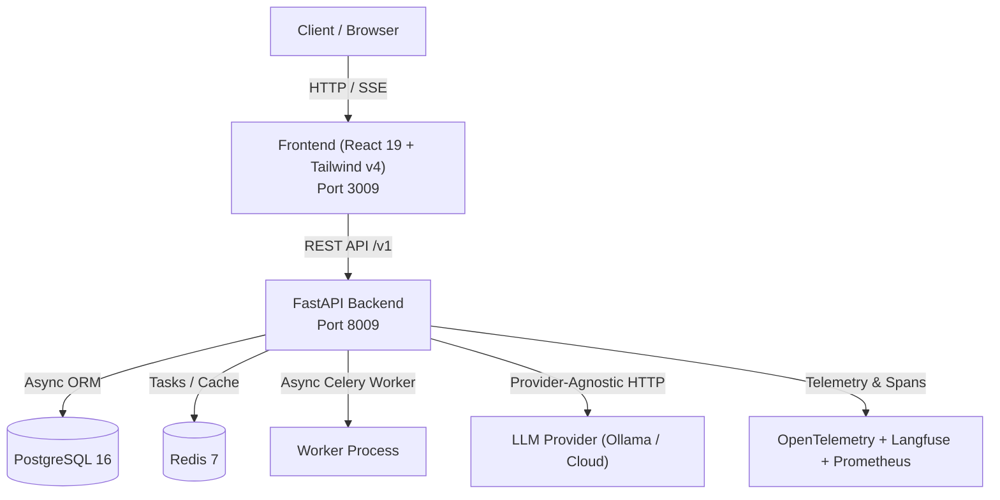

# Ledgerline

> **High-accuracy automated document extraction and matching for accounts payable**

[](https://github.com/Kyrollo/ledgerline/actions)
[](LICENSE)
[](https://www.python.org/downloads/)
[](tests/)

Accounts-Payable Document Intelligence: multimodal OCR/VLM invoice extraction, automated 3-way matching, and human-in-the-loop review

---

## Architecture Overview



## Quickstart

### Prerequisites
- Docker & Docker Compose OR Python 3.12+ & Node 22+
- Local Ollama running (`ollama serve`) or cloud LLM API key

### Running with Docker Compose
```bash
# 1. Clone repository
git clone https://github.com/Kyrollo/ledgerline.git
cd ledgerline

# 2. Configure environment
cp .env.example .env

# 3. Start complete stack (Database, Redis, API, Frontend)
docker compose -f deploy/compose.dev.yml up --build
```

Access services:
- **Web Console**: [http://localhost:3009](http://localhost:3009)
- **Backend API**: [http://localhost:8009](http://localhost:8009)
- **API Documentation**: [http://localhost:8009/docs](http://localhost:8009/docs)
- **Metrics**: [http://localhost:8009/metrics](http://localhost:8009/metrics)

---

## Repository Structure

```text
ledgerline/
├── backend/            # FastAPI async backend, domain logic, AI pipelines
├── frontend/           # React 19 + Vite + Tailwind CSS v4 frontend
├── evaluation/         # Reproducible evaluation harness and benchmarks
├── docs/               # Complete MkDocs Material technical documentation
├── deploy/             # Docker Compose configurations (dev, prod, gpu)
├── scripts/            # CI validation, smoke tests, utility scripts
└── .github/workflows/  # CI/CD pipelines
```

## License
MIT License. See [LICENSE](LICENSE) for details.
