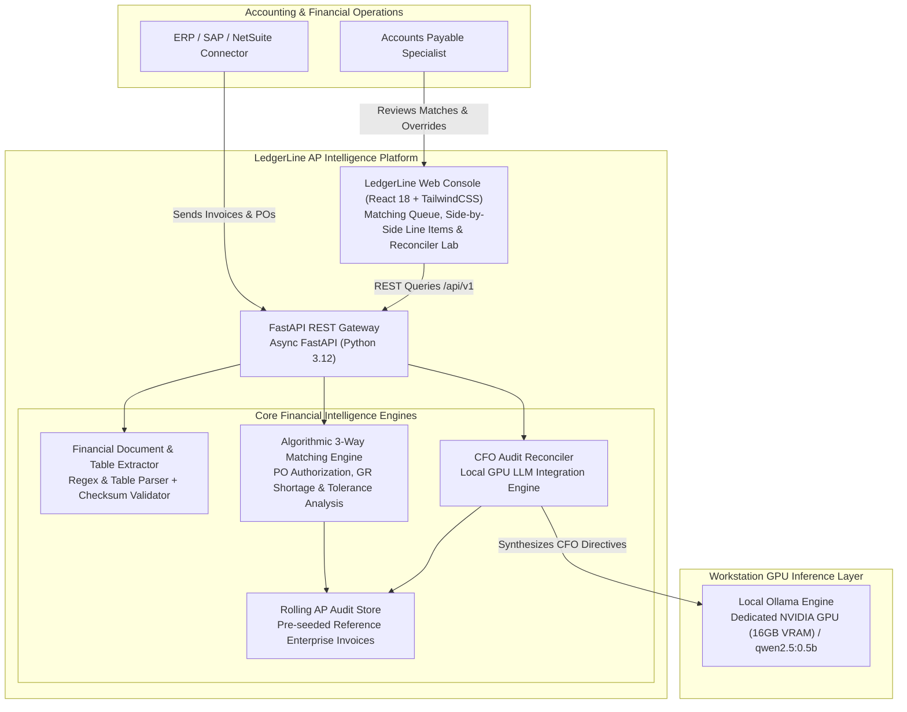
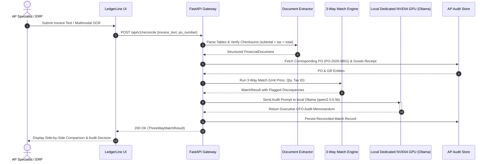

# LedgerLine System Architecture & Financial Intelligence Design

LedgerLine is an enterprise **Accounts-Payable Document Intelligence and 3-Way Matching Engine**. It extracts structured line items from raw OCR invoices, executes deterministic 3-way reconciliation against Purchase Orders and warehouse Goods Receipts, and prompts an on-premise local GPU LLM to synthesize corporate controller audit directives.

---

## 1. C4 Container Diagram

---

## 2. 3-Way Match & Reconciliation Sequence

---

## 3. Core Architectural Modules

### A. Document Table Extractor (`extractor_engine.py`)
- Transforms unstructured OCR text into typed `FinancialDocument` instances.
- Verifies mathematical integrity: ensures `subtotal + tax == total_amount` with floating-point tolerance.
- Extracts vendor names, Tax ID / EIN, document numbers, and individual line items with unit prices and quantities.

### B. Algorithmic 3-Way Matching Engine (`matching_engine.py`)
- Strict verification of Vendor Master Data: flags Tax ID / EIN mismatches as potential fraudulent payment diversion.
- Compares invoice line items against purchase orders: identifies unauthorized line items and calculates dollar variances for unit prices exceeding tolerance thresholds (e.g., 2%).
- Reconciles against warehouse Goods Receipts (GR): identifies physical delivery shortages and flags unfulfilled goods.

### C. Executive CFO Reconciler (`reconciler_engine.py`)
- Employs local GPU LLM (`qwen2.5:0.5b` on NVIDIA Dedicated NVIDIA GPU) to synthesize concise, CFO-grade audit memoranda.
- Generates definitive accounting directives: `APPROVE_FOR_PAYMENT`, `FLAG_FOR_VENDOR_CREDIT`, `HOLD_FOR_RECEIVING`, `FLAG_FOR_FRAUD_REVIEW`.
- Ensures zero financial data leakage by running exclusively on on-premise hardware.
