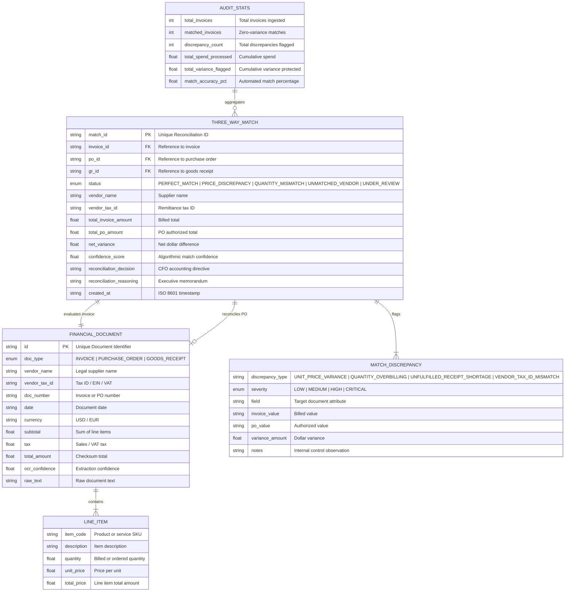

# LedgerLine Data Model & Financial Entity Schema

The LedgerLine data model defines the structural foundation for accounts payable matching, line-item reconciliation, and audit discrepancy logging.

---

## 1. Entity-Relationship Diagram (ERD)

---

## 2. Discrepancy Types & Severity Matrix

| Discrepancy Type | Severity | Description | Recommended AP Action |
| :--- | :--- | :--- | :--- |
| `VENDOR_TAX_ID_MISMATCH` | **CRITICAL** | Invoice EIN differs from Master Vendor Record | Immediate payment freeze; verify supplier banking coordinates |
| `UNFULFILLED_RECEIPT_SHORTAGE` | **CRITICAL** | Billed quantity exceeds warehouse physical receipt | Hold payment for receiving ticket confirmation or credit note |
| `UNIT_PRICE_VARIANCE` | **HIGH** | Unit price exceeds contract PO by > tolerance % | Issue short-payment and request supplier credit memo |
| `UNAUTHORIZED_LINE_ITEM` | **HIGH** | Fee or line item missing from approved PO | Reject line item and request revised invoice |
| `QUANTITY_OVERBILLING` | **HIGH** | Billed quantity exceeds PO authorized quantity | Reconcile with procurement purchaser before approval |
